# PolisOS Project Blueprint

PolisOS is a proposed, open-source civic coordination platform for Romania. This repository contains a versioned system blueprint and an initial development scaffold for a citizen-led problem-to-project workflow. The first slice is nationally accessible on a voluntary basis. Real-world implementation remains subject to the authority and laws of responsible institutions; the current scaffold is not a production government system.

The intended product is a **system of civic and public-service systems**, not a ticket queue. Its operating picture spans public deliberation, evidence, specialist capacity, prices and affordability, jobs and training, production and trade, tourism, essential services, infrastructure, public finance, and delivery outcomes. Each service owns its data and measurement loop; a shared control room shows provenance, uncertainty, exceptions, decisions, and results. Software can coordinate and explain work, while lawful human institutions retain authority.

The platform is intended to help people identify public problems, compare solutions, coordinate work, track commitments, and learn from outcomes. It is not itself a government, a national command system, or a substitute for constitutional institutions. Citizens are rights-bearing participants, not labor units or scores.

New reports stay private to the submitter and reviewers until a reviewer moves them into discussion. Choosing public visibility does not bypass the review gate; private reports remain restricted at every stage.

## Start here

- [Documentation vault index](docs/README.md)
- [System blueprint and boundaries](docs/system/README.md)
- [National operating picture and system services](docs/system/operating-picture/README.md)
- [Citizen experience, rights, and life stages](docs/citizens/README.md)
- [Personal household balance canvas](docs/citizens/household-balance/README.md)
- [Governance and project authority](docs/governance/README.md)
- [Data governance and measurement](docs/data-and-measurement/README.md)
- [Service architecture](docs/architecture/README.md)
- [Security, privacy, and resilience](docs/security/README.md)
- [First workflow: problem to project](docs/first-workflow/README.md)
- [First workflow web interface](apps/web/README.md)
- [Problem review API](services/problem-api/README.md)
- [Project coordination API](services/project-api/README.md)
- [Shared event contracts](packages/contracts/README.md)
- [Local container environment](infra/README.md)
- [Core ontology and entity boundaries](docs/ontology/README.md)
- [Process catalog and workflow states](docs/process-catalog/README.md)
- [Open-source technology direction](docs/technology/README.md)
- [Stages and acceptance](docs/roadmap/README.md)
- [External inspiration and limits](docs/inspiration/README.md)
- [D01–D20 domain map](docs/domains/README.md)

Each chapter is a portable Markdown README. Internal links use standard relative Markdown, and Mermaid source remains readable in GitHub. The optional Canvas board is supplemental; it is not the source of truth.

## Agreed starting decisions

| Topic | Direction |
|---|---|
| Audience | Nationally accessible from the start; use is voluntary |
| First capability | Citizen-led problem-to-project workflow |
| Project authority | Explicit, time-bounded project roles with evidence, review, and appeal |
| National governance | Future proposal: citizens choose among independently vetted executive candidates; requires constitutional and legal compatibility work |
| Citizen data | Opt-in contributions; purpose-limited; account security is separate |
| Monitoring | Prefer public, institutional, operational, and aggregate sources; no default linkage of personal government records |
| Architecture | Independently deployable domain services from day one |
| Events | Apache Kafka from the start, with versioned shared contracts |
| Service languages | Polyglot; domain owners choose within shared contracts |
| Runtime | Containers first; Kubernetes only when operating needs justify it |
| Software | Prefer FOSS; hosting, staffing, support, backups, and incident response still cost money |
| Stack state | React/Vite, Fastify/Prisma, PostgreSQL, Keycloak, and Kafka selected for the first workflow; no prior code was found in this repository |

## System feedback loop

```mermaid
flowchart LR
  W[Real-world conditions] --> O[Observe with provenance]
  O --> M[Measure with uncertainty]
  M --> S[Maintain a bounded state model]
  S --> A[Analyze outcomes and gaps]
  A --> P[Describe a problem]
  P --> C[Co-design options]
  C --> X[Simulate impacts and trade-offs]
  X --> H[Authorize through the proper human institution]
  H --> I[Implement with accountable owners]
  I --> E[Evaluate intended and unintended effects]
  E --> L[Learn, correct, or stop]
  L --> O
  X -. advisory only .-> H
```

Software may help collect evidence, explain options, and track delivery. It cannot grant itself legal authority or make coercive decisions. Each policy or project decision must identify its lawful decision-maker, affected people, assumptions, uncertainty, appeal path, and review date.

## Domains

| ID | Domain | Chapter |
|---|---|---|
| D01 | Identity and Access | [README](docs/domains/D01-identity-access/README.md) |
| D02 | Institutions | [README](docs/domains/D02-institutions/README.md) |
| D03 | Governance | [README](docs/domains/D03-governance/README.md) |
| D04 | Economy | [README](docs/domains/D04-economy/README.md) |
| D05 | Public Services | [README](docs/domains/D05-public-services/README.md) |
| D06 | Infrastructure | [README](docs/domains/D06-infrastructure/README.md) |
| D07 | Supply Chains | [README](docs/domains/D07-supply-chains/README.md) |
| D08 | Environment | [README](docs/domains/D08-environment/README.md) |
| D09 | Human Development | [README](docs/domains/D09-human-development/README.md) |
| D10 | Data and Knowledge | [README](docs/domains/D10-data-knowledge/README.md) |
| D11 | AI and Decision Support | [README](docs/domains/D11-ai-decision-support/README.md) |
| D12 | Measurement and Evaluation | [README](docs/domains/D12-measurement-evaluation/README.md) |
| D13 | Transparency and Audit | [README](docs/domains/D13-transparency-audit/README.md) |
| D14 | Process and Administration | [README](docs/domains/D14-process-administration/README.md) |
| D15 | Simulation and Digital Twin | [README](docs/domains/D15-simulation-digital-twin/README.md) |
| D16 | Citizen Interface | [README](docs/domains/D16-citizen-interface/README.md) |
| D17 | Public Finance | [README](docs/domains/D17-public-finance/README.md) |
| D18 | Justice and Jurisprudence | [README](docs/domains/D18-justice-jurisprudence/README.md) |
| D19 | Defense and National Security | [README](docs/domains/D19-defense-security/README.md) |
| D20 | Diplomacy and Foreign Relations | [README](docs/domains/D20-diplomacy-foreign-relations/README.md) |

## How to read the blueprint

Start with the [system boundary](docs/system/README.md), [citizen safeguards](docs/citizens/README.md), and [data rules](docs/data-and-measurement/README.md). Then read [the first workflow](docs/first-workflow/README.md), [architecture](docs/architecture/README.md), and [technology decisions](docs/technology/README.md). Domain READMEs define the intended remit and observation loop for each subject. A decision marked *open* is deliberately not an implementation commitment.

The domain chapters describe a long-term national service landscape. They do not authorize collection of personal data, create public powers, or imply that every capability belongs in the first release. The [ontology](docs/ontology/README.md) and [process catalog](docs/process-catalog/README.md) define shared concepts and the first workflow.

## Sources and inspiration

- The [Romanian Constitution](https://legislatie.just.ro/Public/DetaliiDocumentAfis/1413) describes Romania as a democratic republic and locates sovereignty in the people; a future governance model needs formal constitutional and legal analysis.
- [GDPR Article 5](https://eur-lex.europa.eu/legal-content/EN/TXT/?uri=CELEX%3A32016R0679) sets purpose limitation and data minimisation principles relevant to personal data handling.
- [NASA systems engineering, OECD participation, Toyota continuous improvement, and Estonia’s X-tee](docs/inspiration/README.md) are reference practices, each with explicit limits.

## Current state

The target repository had only its starter README when audited. No React, Fastify, Prisma, Supabase, database schema, or running service was present to reuse. A local workflow scaffold and a national control-room prototype now exist under apps, services, packages, and infra. Every D01–D20 domain has a small browser-local tool or a link to an existing workspace. The dedicated citizen household balance canvas lets a person change income, taxes, family size, diet, habits, prices, quantities and domestic/external destination estimates; its fictional values remain in browser storage and are not sent to services. Prototype records and figures are fictional/local; no national feeds, AI reviewer, specialist registry, price service, or trade service is connected. This is not a production government system and still needs security, legal, accessibility, data-source, operations, and human review. Earlier planning files were reviewed in the adjacent workspace; useful domain, ontology, workflow, and control-loop material is reconciled into this library. The old drafts are not authoritative when they conflict with decisions above; the reconciliation log records material conflicts and open questions.

## Contributing to the blueprint

When changing a domain boundary, data use, authority, or technology decision, update the owning README and shared contracts. Mark proposals as open until the responsible domain owner and affected stakeholders have reviewed them. Record evidence and unresolved trade-offs instead of silently converting an aspiration into a requirement.

Use the [roadmap and acceptance criteria](docs/roadmap/README.md) to guide the next implementation stages and production readiness work.
