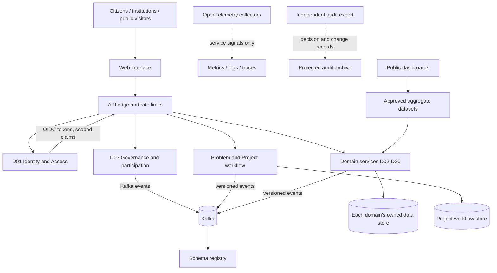
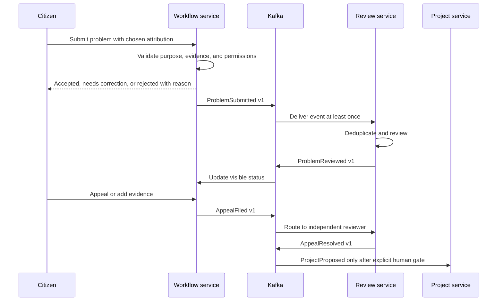
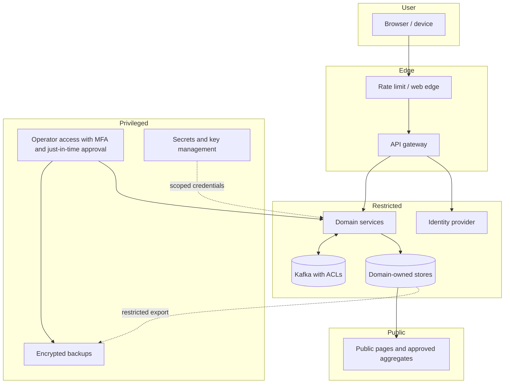

# Service Architecture and Boundaries

## Purpose and outcomes

PolisOS uses independently deployable domain services from day one, as selected by the project. Each service owns a bounded data model and publishes versioned contracts. This choice increases operational complexity, so the architecture must provide common identity, API, event, security, backup, observability, and recovery standards before services multiply.

## Architecture view

This diagram is conceptual. The first workflow may have a small number of services, but domain boundaries and independently deployable ownership are part of the accepted direction. Avoid a shared writable database. Cross-service workflows use explicit sagas and compensating actions, not hidden database joins.

## Service boundary rules

1. One domain owns each authoritative record and its schema.
2. Other services use versioned APIs or subscribe to published events; no direct writes to another domain's store.
3. Events describe completed facts, not commands disguised as notifications.
4. Every event has an owner, schema version, purpose, classification, retention, and compatibility policy.
5. Sensitive payloads are minimized. A link or opaque identifier is not permission to retrieve data.
6. Idempotency keys, replay rules, dead-letter handling, and bounded retries are specified for every event consumer.
7. Human decisions and authorizations are separate from technical service status.
8. Public analytics consume approved aggregates, not production databases.
9. Service telemetry must not quietly collect citizen content or build behavior profiles.
10. Each service needs an independent export and migration path.

## Shared contracts

- API: OpenAPI for HTTP; versioned REST first unless a domain owner demonstrates a need for gRPC.
- Events: Kafka topics with schema evolution controls. Avro plus Apicurio Registry is a candidate; JSON Schema or Protobuf may fit a domain if it interoperates and is governed.
- Identity: OIDC/OAuth2 with short-lived scoped claims; no shared service passwords for users.
- Authorization: least privilege, role and attribute scoping, separation of duties, and explicit project charter.
- Data: shared identifiers and semantics, not a central all-purpose database.
- Observability: OpenTelemetry traces, metrics, and logs with personal-data redaction and bounded retention.
- Security: signed releases, secret management, vulnerability response, audit logs, backup restore practice, and threat modeling.
- Errors: stable machine-readable codes and plain-language user explanations.
- Compatibility: documented version support and deprecation window.

## Asynchronous workflow pattern

## Security boundaries

Public exposure uses approved aggregates or public records. The diagram excludes private or sensitive operational layouts. Defense, health, child, and justice details require separate protections and may not be published.

## Hosting and recovery

Use OCI-compatible containers and local compose-style development first. Kubernetes is deferred until measured service count, availability needs, scaling, and operator capacity justify its control-plane and staffing burden. Deployment decisions include hosting region, backups, restore objectives, incident roles, dependency inventory, and an exit plan. FOSS licenses do not remove operating costs.

## Additional national system services

The control room is a read model over independently owned domain services. It is not a shared writable database. The following boundaries are proposed; each service requires its own owner, stack decision, data agreement, API/event contract, operating budget, and exit path before deployment.

| Service boundary | Owner domain | Owns | Publishes to |
|---|---|---|---|
| Deliberation and evidence | D03 / D10 | Topics, claims, arguments, evidence references, support, moderation and corrections | D11 review queue, public debate read model, decision brief |
| Source and indicator registry | D10 / D12 | Source metadata, definitions, methods, revisions, uncertainty and correction links | Domain dashboards, D13 audit, public catalog |
| Workforce capacity | D09 / D04 | Aggregated specialist capacity, qualification taxonomy, coverage and skills pathways | Workforce dashboards, education and service planning |
| Price and affordability | D04 / D12 | Comparable goods/service observations and basket series | Cost-of-living dashboard and economic analysis |
| Employment and opportunity | D04 / D09 | Verified employers, job listings, training paths and business opportunity listings | Opportunity search and aggregate skills-gap analysis |
| Production and trade chain | D07 / D04 | Resource batches, transformations, custody, trade aggregates and chain corrections | Product trace, resilience and environmental analysis |
| Tourism and visitor capacity | D04 / D06 | Attraction metadata, access conditions and safe visitor-flow aggregates | Tourism, transport and local-service planning |
| Service demand and schedules | D05 / D06 | Service hours, anonymized demand profiles and schedule options | Accountable service owners and the public dashboard |
| National control-room read model | D16 / D10 / D12 | Approved, cached aggregate projections and source freshness | Browser interface only; no authoritative writes into domain stores |

## Deliberation and AI integration

The deliberation service emits its own versioned facts (for example `ArgumentSubmitted.v1` and `ArgumentCorrected.v1`). A D11 worker may subscribe to a bounded claim-review request and return structured findings with model/version, evidence references, affected text spans, confidence, abstention reasons and challenge path. The deliberation owner presents that result as advice. A model result does not advance the policy state or authorize an action by itself.

Aggregate and operational integrations must name the accountable source controller, legal/purpose basis, license, cadence, geographic resolution, data-quality test, retention, and correction contact. Citizen-supplied data remains an optional, separately scoped source. Do not use a platform-wide identity join to assemble a national person profile.

## Open decisions

API gateway and service mesh; secrets/key management; object storage; audit retention; backup topology; Kafka cluster sizing and recovery objectives; event schema format; deployment automation; whether and when Kubernetes is operationally justified.

