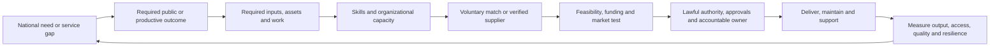

# Productive Capacity and Business Feasibility

## Purpose

Connect national needs and available productive capability to practical, financially testable work. The first example is a Romanian tailoring workshop. The longer-term model should help residents and institutions ask: what output is needed, which inputs and skills are missing, who may provide them, what approvals are needed, and can the activity cover its costs and grow?

This is an advisory planning tool. It does not incorporate a business, certify demand, issue a licence, grant funding, confirm legal compliance, or replace accounting, engineering, employment, legal, or authority advice.

## National capability model



The national map must cover food and water; energy; industry and repair; transport and infrastructure maintenance; healthcare and education; police, fire and emergency medical response; public administration and finance; defense and civil resilience; and productive businesses, tourism and exports. Each capability is described by its output, inputs, people and assets, geographic reach, skill requirements, owner, source quality, resilience risks, and delivery evidence.

The map is not a command queue for citizens. A person may voluntarily describe skills and availability, inspect why a need appears relevant, and opt into a conversation. Qualifications for regulated work are verified by their proper issuer or employer. Employers and institutions retain their hiring, staffing and service responsibilities. No civic activity or personal profile creates a hiring score or automatic assignment.

## Tailoring-workshop feasibility model

The browser prototype uses editable assumptions saved to local storage. All example values are fictional. Users enter a location and legal form; rent or purchase and premises size; deposit, loan payment and fit-out; machinery, tools, initial materials, setup support and opening reserve; utility estimates; team size, loaded cost per paid role and productive hours; and a mix of products or services.

For each offering, the model compares an editable public-market price reference with the planned sale price, expected units per month, direct material cost per unit, labor hours per unit, and the reference source. Examples include alterations and repairs, custom garments, and uniforms/workwear.

The user can also enter a local-material share and supplier/origin note per product, plus an expected export-sales share. The page estimates monthly local-material spending, imported-or-unverified material spending, domestic sales and export receipts separately. These are user-entered scenario inputs, not national trade statistics or verified origin claims. Unknown origin must remain distinguishable from a confirmed import.

### Calculation and limits

Let `D` be entered monthly demand hours and `H` be the entered available productive hours. The feasible-volume factor is `min(1, H / D)` when `D` is positive. This prevents projected output from exceeding the modeled labor capacity; it is a rough planning rule, not a production schedule.

```text
feasible units per offering = planned units × feasible-volume factor
revenue = Σ(feasible units × planned price)
direct materials = Σ(feasible units × material cost per unit)
contribution = revenue − direct materials
monthly fixed cost = occupancy payment + utilities + paid roles + other monthly costs
operating result = contribution − monthly fixed cost
break-even revenue = monthly fixed cost / contribution margin rate
startup cash = rent deposit OR entered property purchase amount
               + fit-out + machines + tools + opening materials
               + professional setup + opening cash reserve
```

The page also shows prudent, entered, and higher-demand scenarios. The model does not calculate Romanian tax, VAT, social contributions, eligible grants, statutory wages, legal permit fees, depreciation, inventory financing, or a full debt schedule. Add founder compensation as a paid role when appropriate. Users need to include financing, taxes, replacement costs, seasonality, working capital, returns, and sensitivity analysis before relying on a plan.

## Authority and document checklist

The page provides a tracker for activity classification and legal form; entity registration and declared work locations; premises use and construction/fit-out; local operating permissions; fire-safety applicability; hiring and worker protection; tax, invoicing and customer payments; textile waste; consumer/product information; and industrial licensing scope.

Each authority area expands into a locally saved preparation checklist: candidate forms, evidence and questions to take to the authority. Every line is marked as an item to confirm, not a guaranteed statutory requirement. The user can record which preparation items are ready, add the authority's answer/reference and link the applicable official source. Checklist completion does not validate documents or mean the authority has approved the business.

Every item starts **“De verificat”**. Applicability depends on the specific legal form, activity, location, building, sales channel, staff and current rules. The user records the authority's answer, case/reference number, official source URL and status. “Consemnat ca obținut” means only that the user recorded this state; PolisOS does not validate the underlying document. The checklist cannot establish that it is complete.

Official references to review, accessed 2 November 2026:

- [ONRC CAEN Rev. 3 activity lookup](https://caen.onrc.ro/) and [ONRC information on CAEN Rev. 3](https://www.onrc.ro/documente/anunturi/2024/INFORMARE%20CAEN%20.pdf). Confirm the latest forms and filing checklist with ONRC for the selected legal form.
- [REGES-ONLINE / Labour Code information](https://reges.inspectiamuncii.ro/informatii-utile/codul-muncii/?faqid=8035). The current official information says employment contracts are concluded and recorded before the employee starts; the application must track the applicable current procedure, not substitute for it.
- [IGSU fire-safety information](https://isuvn.igsu.ro/avizare-autorizare/informare-376). Applicability depends on the premises and project; the workshop example must not imply a fire-safety authorization is automatically required.
- [PCUEL industrial single-licence portal](https://pcuel.oli.gov.ro/ro/). PCUEL describes a mechanism for industrial activities; a small tailoring workshop must not be assumed to fall in its scope.
- [ANAF services](https://www.anaf.ro/). Verify invoicing, tax and cash-register obligations against the current entity, customers, payment methods and rules; do not bake a static tax rate into the feasibility model.
- The [selected municipality], territorial labour inspectorate, local fire inspectorate, and competent waste/environment authority must be recorded for the workshop address. Local rule and source URLs remain user-editable.

## Data and privacy

The current prototype saves assumptions, market-reference text and checklist statuses in the same browser under `polisos.business-planner.tailoring.v1`. It does not send a business plan, employee data, credentials or documents to PolisOS. It has no document upload. Users should not put personal identifiers, contract contents or confidential business information in the free-text reference fields on a shared device.

The capacity page stores a small self-declared skill/interest profile locally under `polisos.capacity-opt-in.v1`; no skill matching or interest record is sent to an institution. A future national aggregator must separate voluntary individual profiles from institution-owned workforce aggregates, publish a clear opt-in purpose and withdrawal path, suppress small sensitive groups, and allow employers to verify regulated credentials at the source.

## Delivery stages

1. **Capability ontology:** agree national outcomes, service owners, skill codes, resource categories, source confidence and privacy boundaries.
2. **Local planning prototype:** household capacity suggestions and tailoring-shop unit economics with editable assumptions and no live claims.
3. **Regional business evidence:** obtain consented price, rent, wage, input and demand references with source, date, unit, reuse terms and correction route.
4. **Authority workflow:** maintain versioned per-activity and per-locality checklists, issuing body, legal basis, prerequisites, forms, fees, timing, expiry and official source; publish change history and review date.
5. **Institutional integration:** only with a named data owner, lawful basis, security review, operating agreement, human approval and exit path.

## Open decisions

- Which Romanian datasets can support regional rents, utility bills, wages, input costs, public procurement demand and textile-market volumes with reuse rights?
- How should the system represent cooperatives, self-employed work, micro-enterprises and public/private suppliers consistently?
- Which agencies can keep authorization paths current for each activity and locality?
- What capital-financing, tax, VAT, cash-flow and risk modules should be added after accountant review?
- How should voluntary individual skill matching connect to institution-verified qualifications without creating a compulsory worker registry?
