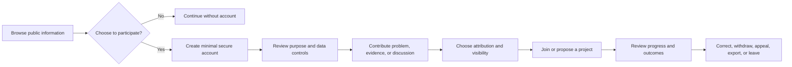

# Citizens Rights Experience and Life Stages

## Purpose and outcomes

The platform should help people contribute knowledge, raise a concern, deliberate, join a project, learn, and see whether responsible institutions acted. A good experience protects choice, dignity, accessibility, and the right to leave. It should not make social worth, employability, or access to public services depend on an account or participation score.

## Citizen treatment and rights

| Commitment | Product consequence |
|---|---|
| Participation is voluntary | Public information remains readable without an account where feasible; no penalty for non-use |
| Purpose limitation | Each personal-data field has a stated purpose, lawful basis where required, access list, retention, and withdrawal path |
| Data minimisation | Collect the least information required; separate authentication from optional civic profile |
| Private by default | Profile fields and contributions are private or pseudonymous until the person chooses a visibility level |
| No citizen ranking | No global citizen score, labor rank, competence leaderboard, or eligibility decision from participation |
| Human dignity | Accessibility, language access, disability accommodation, low-bandwidth and assisted channels |
| Due process | Notice, explanation, correction, appeal, and human review for consequential moderation or workflow decisions |
| Child safety | Age-appropriate design, minimum collection, no public profiles for children by default, guardian support where lawful |
| Exit and portability | Export, correct, withdraw optional contributions where legally and technically possible, close account |
| Non-discrimination | Assess impacts across groups without turning sensitive traits into individual decision rules |

## Life stages

Life-stage support is a design lens, not a central dossier. Children, students, working-age adults, caregivers, older people, and people with disabilities should be able to find relevant services and participation pathways. The platform should not infer a person’s needs from a mandatory profile.

| Life stage / context | Possible voluntary support | Safeguards |
|---|---|---|
| Children and young people | Age-appropriate learning and civic participation information | No public directory, behavioral ad targeting, dating features, or unconsented profiling |
| Families and caregivers | Links to service information and optional coordination tools | Do not build family graphs or infer dependency/health status by default |
| Learners | Optional skills portfolio, course and project opportunities | No automated school placement, high-stakes pupil ranking, or permanent reputation score |
| Workers and job seekers | Optional CV export, skills evidence, project roles | No labor surveillance, compulsory availability, or employment decisions from civic data |
| Older adults | Accessible civic information, mentoring and local project options | No age-based exclusion or assumed incapacity |
| People needing accommodations | User-controlled access preferences and accommodation requests | Keep disability and health details out of general profile and analytics |

Legacy brainstorming proposed dating, relationship matching, detailed health diaries, pregnancy tracking, family trees, social graphs, personality tests, and child development timelines. Those concepts are not part of the initial design. Dating and social matching are out of scope; health and child records require separate specialist products, law, consent, and safety analysis if ever proposed.

## Profile and account model

An account is created only for a feature that needs authenticated participation. Authentication credentials and security events live in the identity boundary. Optional profile modules are separately consented, individually visible, and removable. A project may ask for evidence of a capability relevant to that role, but should not require a broad life history.

The first-release profile may include a chosen display name, language, accessibility preferences, location at a granularity selected by the user, interest areas, and voluntary skill evidence. Legal identity verification is feature-specific, proportionate, and not required for reading public material. Identity proofing must not turn the platform into a central government register.

## Citizen journey

## Roles and authority

Citizens can submit, discuss, review, volunteer, or hold scoped project roles. Role selection must have published requirements, conflict-of-interest disclosure, time limits, peer review, and a challenge route. A project role grants only the authority specified in that project charter. It does not confer social rank, public office, or authority over unrelated services.

## Data and feedback

Citizen contributions are opt-in and kept distinct from account-security records. Surveys disclose sampling and self-selection limits. Volunteer participation is not representative of the whole population without a valid sampling method. Aggregate dashboards should suppress small groups and sensitive combinations that can identify people.

## Failure, complaint, and appeal

Provide accessible ways to correct profile data, report harassment, contest content moderation, appeal project-role decisions, withdraw consent, and request help without retaliation. Preserve a safe record for due process while applying a published retention schedule. Appeals go to a reviewer independent of the original decision where practicable.

## Delivery phases

- **Foundation:** guest access to public information; minimal account security; clear consent and visibility controls.
- **First workflow:** problems, evidence, deliberation, volunteer roles, project milestones, appeal and exit.
- **Later:** optional learning and skills portfolios after necessity and child-safety review.
- **Deferred or excluded:** dating, social graph mining, behavioral scoring, continuous health tracking, inferred traits, and compulsory profiles.

## Stack record

Use shared identity and frontend decisions in [technology](../technology/README.md). Candidate interfaces are React, TypeScript, and Vite. Authentication may use an OIDC provider such as Keycloak; this is not an adopted product choice. FOSS license review, operating cost, threat model, interoperability, backups, and migration path are required before selection.

