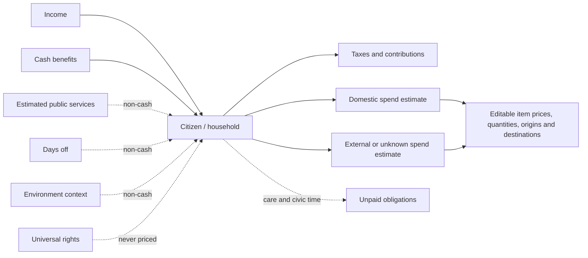

# Citizen Household Balance Canvas

## Purpose and boundary

The household balance canvas is a voluntary, personal budgeting view. It helps a person compare household cash income, benefits, taxes, expenses, public services they estimate using, and an approximate domestic versus external share of spending. It is a sandbox for household choices and economic literacy, not a national accounts model, benefit decision, tax calculator, measure of civic worth, or government monitoring tool.

This page does not grant or remove rights. A person's access to rights or services must never depend on whether they use this page, their income, tax contribution, consumption, habits, employment, or family size.

## Citizen experience

The person can edit monthly income and its source label, benefits, manually entered taxes and contributions, household size, days off, care/civic hours, and a personal environment rating. They can choose a plant-based diet, add alcohol or smoking expenses, edit product and service prices and quantities, and describe the assumed provider or destination. A household-size setting scales lines marked per-person.

Optional replacement-value estimates describe public services the household uses. They are displayed as an illustrative non-cash return and are not treated as a refund, the provider's cost, a legal entitlement, or an amount netted against taxes.

## Flow model

Solid flows represent money. Dashed flows represent time or non-cash context. The model does not convert rights, environment, care, or days off into RON. The domestic/external split is an editable household estimate; it does not prove where a product was made, who owns a supplier, where a worker is paid, or where tax revenue is recorded.

## Roles and authority

The individual controls the assumptions in their own browser. PolisOS has no role in validating the household's entries. The output is not an institutional ranking and must not be used to select project leaders, assess employability, allocate public services, determine eligibility, or profile a family.

## Data and privacy

The prototype saves this page's settings in the browser's `localStorage` under `polisos.citizen-balance.v1`. Values are not sent to PolisOS APIs. The user can reset the example values or clear the site's browser data. This browser-local approach is a prototype boundary, not a promise of encryption or protection from other people who use the same browser profile; do not enter sensitive financial, health, or family details on a shared device.

Default numbers and provider descriptions are fictional examples. No current Romanian tariff, official benefit, tax rule, price feed, product origin, employer, or public-service cost is connected. Any later external source must include provenance, timestamp, unit, method, coverage, uncertainty, correction process, and an opt-in decision before personal purchase or profile data is collected.

## Measures and feedback

The page calculates monthly cash in, itemized expenses, manually entered taxes/contributions, remaining cash, and estimated domestic and external/unknown spending shares. Per-person lines scale by the entered household count. Changing prices, quantities, diet, habits, or household size recomputes those totals immediately.

The domestic share is a planning proxy based on user-entered percentages. “External / unknown” is not a measure of capital flight. These totals are household estimates and cannot be extrapolated to a population without a documented, representative, consented method and independent review.

## Failure, correction, and appeal

There are no institutional decisions or automated classifications to appeal in this local tool. The user can edit every assumption or restore examples. If a future version imports external prices or service estimates, it must show source and freshness, permit correction, preserve provenance, label missing or mixed origin, and provide a human complaint path before publishing aggregates.

## Integrations and delivery phases

- **Current prototype:** React view; in-browser calculations and `localStorage`; no API, account, tracking script, or data feed.
- **Next design stage:** document sourced, region-specific price observations and opt-in receipt submission separately; define licensing, sample bias, anti-fraud review, aggregation thresholds, and retention before integration.
- **Later:** only connect official service and economic aggregates through documented contracts. Never link household entries to tax, health, employment, identity, or benefit records by default.

## Stack record

This is a UI component in the existing React/TypeScript/Vite web app, with no new service or dependency. Browser storage makes the prototype portable but is not a multi-device account store or a secure financial vault. Any server-backed successor needs purpose-specific consent, access control, retention, export/deletion rules, threat modeling, hosting/backup costs, open data contracts, and a migration path back to a local export.

## Open decisions

- Which public and commercial sources can provide current regional prices with lawful reuse terms?
- Should users enter household-level quantities directly or choose a per-person/household scale per line?
- Which method can describe mixed domestic value without suggesting that supplier location equals product origin?
- How should future service estimates communicate non-comparability and avoid implying that rights or public value can be reduced to money?
- What local export and deletion affordances should be added before collecting more sensitive assumptions?

## Related chapters

- [Citizen rights and profile boundaries](../README.md)
- [Economic observation and affordability](../../domains/D04-economy/README.md)
- [Public finance and taxes](../../domains/D17-public-finance/README.md)
- [Citizen interface](../../domains/D16-citizen-interface/README.md)
