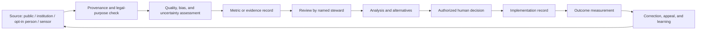

# Data Governance and Measurement

## Purpose and outcomes

Measurement should help people notice a problem, understand uncertainty, compare options, and evaluate results. It must not become an excuse for continuous citizen surveillance. Every domain uses the same feedback logic but keeps personal data, service telemetry, and national outcome indicators separate.

## Three data planes

| Data class | Examples | Default rule | Typical access |
|---|---|---|---|
| Account-security data | Login identifier, authenticator metadata, recovery events, security audit | Collect only what is needed to secure an account; keep outside civic profiles | Narrow identity/security operators |
| Voluntary citizen contributions | Problem reports, testimony, optional skills, project participation, preferences | Explicit opt-in per purpose; private or pseudonymous by default; withdrawal and retention rules | Contributor, assigned reviewers, authorized project participants |
| Operational service telemetry | Availability, latency, errors, queue depth, deployment health | No user content or direct identifiers unless needed for incident response; short retention | Service operators and security staff |
| Institutional and public data | Budgets, service outputs, law, registries, environmental readings, public statistics | Record source, legal basis, update date, license, quality, and limitations | Public when lawful and safe |
| Aggregate outcome indicators | Waiting times, access, reliability, emissions, project outcomes | Publish definitions, denominator, scope, uncertainty, revisions, and suppression rules | Public aggregates; restricted raw data where necessary |

There is no default cross-link to individual government records. Any future integration needs a purpose-specific legal basis, data protection impact assessment where required, independent security review, minimisation, access controls, retention and deletion rules, and a meaningful alternative for people who opt out where feasible.

## Purpose and collection register

Each dataset or event must document:

| Field | Required question |
|---|---|
| Purpose | What decision or learning need does this serve? |
| Authority | Who may collect it and under what basis? |
| Source and provenance | Who observed or supplied it, when, by what method, and under what license? |
| Subject | Is it about a person, institution, place, project, service, or asset? |
| Consent | Is participation optional? How is consent captured, withdrawn, and audited? |
| Minimisation | Which fields can be removed, coarsened, or derived locally? |
| Quality | What are coverage, sampling bias, measurement error, uncertainty, and revision history? |
| Access | Who can read, export, correct, publish, or delete it? |
| Retention | When is it deleted, aggregated, or archived, and why? |
| Harm | Could disclosure expose a child, patient, worker, vulnerable group, facility, or defense asset? |
| Trigger | What actions may evidence support, and what actions are prohibited? |

GDPR Article 5 includes purpose limitation and data minimisation; translate these into specific purpose, access, retention, and review rules, with legal counsel determining obligations for each deployment ([official text](https://eur-lex.europa.eu/legal-content/EN/TXT/?uri=CELEX%3A32016R0679)).

## Observation and control loop

The loop includes delay, uncertainty, external causes, and unintended effects. Correlation does not establish causation. A dashboard alert may request investigation; it cannot automatically sanction a person, deny a service, or redirect public funds.

## Indicator record

Every indicator states: name; purpose; numerator and denominator; unit; geographic and population scope; source; collection cadence; lag; owner; method; uncertainty and missingness; disaggregation; privacy threshold; baseline; known confounders; revision policy; permitted interpretations; prohibited automated actions; and review date.

## Consent and individual data

- Consent is separate from accepting platform terms.
- Declining optional data use must not remove unrelated access.
- No default linkage of a citizen profile to medical, education, tax, employment, policing, or voting records.
- Public profiles are not required for civic contribution.
- Sensitive-data use requires documented necessity and lawful basis, not just a checkbox.
- Suppress or coarsen small aggregate cells where re-identification is plausible.
- Citizen-submitted reports may contain third-party data; provide notice, minimisation, redaction, and correction paths.
- Research use is separately described, governed, and reviewed.

## Service telemetry versus public outcomes

Service telemetry answers whether software is operating (availability, errors, throughput, incident response). National outcome indicators answer whether services and conditions are changing (access, reliability, waiting time, educational outcomes, safety, emissions). Neither is an individual citizen score. Keep platform observability in the infrastructure stack and public measurement in domain-owned indicator registries.

## Domain observation matrix

Each D01–D20 chapter defines an observation loop with source, steward, cadence, uncertainty, allowed use, and prohibited inference. Cross-domain aggregates join only at an explicitly reviewed level and must not become personal dossiers.

## Failure, appeals, and corrections

People and institutions can challenge a data point, request provenance, submit a correction, appeal a consequential interpretation, and see correction history. Preserve prior revisions for audit while marking superseded values. Provide an independent route when the data owner is implicated.

## Stack record

The first workflow uses PostgreSQL with separate service-owned databases and Keycloak for identity; the broader national data architecture remains open. Compare self-hosted PostgreSQL/PostGIS plus a separate identity provider with self-hosted Supabase only when a domain owner defines a concrete need and operating plan. PostgreSQL uses its own permissive license; PostGIS is GPLv2. Self-hosted Supabase has a different feature and operations profile from its managed service ([self-hosting guidance](https://supabase.com/docs/guides/self-hosting)). See [technology records](../technology/README.md) for cost, security, interoperability, and exit requirements.

