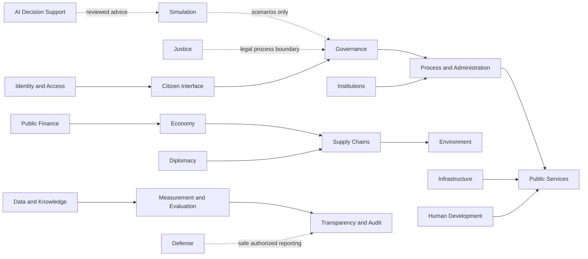

# National Domain Map D01 to D20

## Purpose and outcomes

The domain map divides the national subject area into accountable information and coordination boundaries. Each domain has its own README with purpose, participants, authority, workflow, observation, data/privacy, measures, failure/appeal, integrations, delivery phases, technology record, and open questions.

A domain boundary does not create a public institution or authority. Domain indicators are descriptive and must state uncertainty and what actions they cannot trigger.

## Canonical domains

| ID | Domain | Main responsibility |
|---|---|---|
| D01 | Identity and Access | Authentication, scoped authorization, organisation identifiers, consent and privacy preferences |
| D02 | Institutions | Institutional mandates, service owners, responsibilities, structure, and public reporting |
| D03 | Governance | Policy proposals, consultations, decision records, elections/participation research, accountability |
| D04 | Economy | Firms, cooperatives, work, production, services, agriculture, industry, trade and economic coordination |
| D05 | Public Services | Service availability, access and quality for healthcare, education, housing, mobility and social support |
| D06 | Infrastructure | Transport networks, utilities, connectivity, public assets, capital works and maintenance |
| D07 | Supply Chains | Inputs, suppliers, transformations, logistics, inventory risk, imports, exports and product provenance |
| D08 | Environment | Natural systems, extraction impacts, pollution, emissions, circularity and restoration |
| D09 | Human Development | Education and skills, health service pathways, life-stage support, workforce participation and inclusion |
| D10 | Data and Knowledge | Catalogs, definitions, provenance, public evidence, research and knowledge stewardship |
| D11 | AI and Decision Support | Bounded assistive models, evaluation, transparency and human review |
| D12 | Measurement and Evaluation | Indicator definitions, baselines, uncertainty, program evaluation and outcome learning |
| D13 | Transparency and Audit | Public reporting, decision/change trails, procurement visibility and independent audit |
| D14 | Process and Administration | Administrative workflows, permits, enrollment, case routing, service obligations and appeals |
| D15 | Simulation and Digital Twin | Scenario models, sensitivity analysis, alternatives and model governance |
| D16 | Citizen Interface | Accessible web/mobile journeys, news, discussion, notifications and contribution controls |
| D17 | Public Finance | Public budgets, revenue, expenditure, procurement, transfers, audit and fiscal scenarios |
| D18 | Justice and Jurisprudence | Public legal information, process navigation, legal change history and lawful referral |
| D19 | Defense and National Security | Civil preparedness and authorized high-level reporting, with strict sensitive-data boundaries |
| D20 | Diplomacy and Foreign Relations | Treaties, international cooperation, external trade context and interoperable public exchange |

## Topic coverage

| Requested subject | Domain(s) |
|---|---|
| Economy, agriculture, industry, production and services | D04 |
| Tourism and local visitor economy | D04, D05, D09 |
| Imports, exports, trade and product-chain tracing | D04, D07 |
| Resource extraction and environmental effects | D04, D07, D08 |
| Circular economy and domestic value-added scenarios | D04, D07, D08, D17 |
| Price observatory for essentials, utilities, housing and transport | D04, D05, D12 |
| Jobs, business opportunities, skills demand and graduate pathways | D04, D09, D10 |
| Specialist capacity by discipline and region | D04, D05, D09, D12 |
| Structured public debate, arguments, evidence and claim review | D03, D10, D11, D16 |
| Aggregate time-use and public-service opening schedules | D05, D06, D09, D12 |
| Healthcare, education and social services | D05, D09 |
| Transport, utilities and infrastructure | D05, D06 |
| Workforce enrollment, training and job participation | D04, D09, D14 |
| Law, administration, permits and appeals | D03, D14, D18 |
| Public budgets, money flow and procurement | D02, D13, D17 |
| Defense and resilience | D19 |
| Diplomacy, treaties and international trade | D20 |
| News, discussion, public dashboards and corrections | D10, D13, D16 |
| Monitoring, indicators and learning | D10, D12, D13 |

## Domain relationships

The arrows describe possible information and contract relationships, not authority to reuse personal records. Each connection needs a purpose, legal basis, minimum data, access control, retention, and owner.

## Shared domain observation contract

Every observation record describes what is observed, source and provenance, steward, cadence, uncertainty and missingness, scope, review, public/private classification, decisions it can inform, actions it cannot automatically trigger, retention, and correction path. For citizen reports, contribution is opt-in. For public and institutional sources, record license and quality. For telemetry, avoid citizen content and separate it from national outcomes.

## Shared stack contract

Each domain owner may choose an internal language, framework, and store. Services must meet the shared API, event, identity, privacy, security, audit, accessibility, observability, backup, export, and compatibility standards in [architecture](../architecture/README.md). Every domain README records an open or selected stack decision with software license, host/operations cost, security, interoperability, and migration notes.

