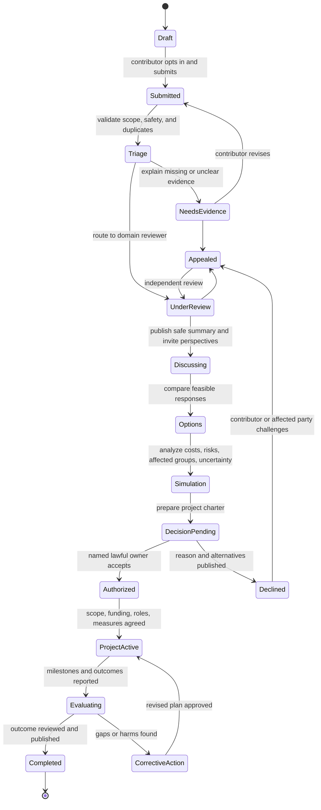

# First Workflow From Citizen Problem to Project

## Purpose and outcome

The first capability lets a person or group describe a problem, attach evidence, receive review, discuss options, and propose a bounded project with an accountable owner. A citizen should see what happened, why, who is responsible, the next step, and how to appeal. Participation is voluntary and the process is nationally accessible.

A problem record does not automatically become a public project. An authorized institution or consenting sponsor must accept responsibility, authority, resources, and safety obligations before real-world implementation.

## Workflow and states

## Roles and authority

| Actor | Responsibility | Limit |
|---|---|---|
| Contributor | Describes the problem and chooses attribution/visibility | Submission does not make them the case owner |
| Triage reviewer | Checks scope, safety, duplication, routing, completeness | Cannot decide policy or suppress criticism outside a published rule |
| Domain reviewer | Checks evidence and identifies expertise | Advice is not approval |
| Facilitator | Supports accessible, balanced discussion | Does not decide the outcome |
| Project proposer | Drafts options, scope, milestones, and resource assumptions | Cannot authorize own public budget or legal mandate |
| Accountable owner | Accepts or declines the project under valid authority | Publishes reasons, resources, and review route |
| Project team | Delivers approved work and reports milestones | Scope and roles stay within the charter |
| Independent reviewer | Handles appeals, conflicts, and outcome evaluation | Should not be subordinate to the original decision-maker |

## Citizen experience

- Browse reports and progress without an account where safe.
- Submit under a chosen display identity; do not publish a real-world identity by default.
- Add or correct evidence, request accommodation, and receive understandable status updates.
- Select contribution attribution and visibility.
- Join a team only after seeing its charter, workload, safety requirements, role criteria, and exit option.
- Leave or withdraw optional personal information without erasing required institutional audit records.
- Appeal rejection, moderation, role selection, or data handling through an independent route.

## Evidence and data

Each evidence item stores source, attribution choice, timestamp, method, license/permission, location precision, confidence, and correction history. Personal details about third parties are minimized or redacted. Evidence can be contested; reviewers record rationale and uncertainty. Do not collect sensitive records simply because they might be useful later.

New reports are not visible to the public until a reviewer moves them into discussion. Before that state, only the submitter and reviewers can retrieve them. A report marked private remains access-restricted throughout. Unpublished report text is omitted from Kafka events.

## Project charter

Before activation, a project has: problem statement; affected parties; public-interest outcome; lawful accountable owner; scope and exclusions; alternatives; authority and funding; roles and criteria; milestones; risk and accessibility plan; procurement/asset dependencies; measures and baselines; data collection plan; publication level; conflict disclosures; appeal contact; sunset/review date; stop conditions.

## Failure modes and appeal

Common failures include duplicate or misrouted reports, inaccessible discussion, captured review, false evidence, missing authority, unavailable funding, adverse effects, retaliation, and incomplete milestones. Distinguish “submitted,” “accepted for review,” “authorized,” “funded,” and “implemented.” Silence or a popular vote is not approval. Appeals should pause irreversible steps where law and safety allow.

## Events and integration

Candidate events: ProblemSubmitted, EvidenceAdded, TriageCompleted, ProblemNeedsEvidence, ProblemRouted, ReviewRecorded, DiscussionOpened, OptionProposed, SimulationPublished, ProjectProposed, ProjectAuthorized, ProjectDeclined, RoleAssigned, MilestoneReported, AppealFiled, AppealResolved, OutcomeEvaluated, ProjectClosed. Each event is versioned, minimal, attributable, and idempotently consumed. Avoid embedding personal or sensitive content in Kafka; publish opaque references and retrieve them only under authorization.

## Stack record

The first workflow uses React/TypeScript/Vite, separate Fastify/Prisma APIs, PostgreSQL, Keycloak OIDC, and Kafka. Versioned JSON Schema is stored in Git; a schema registry remains open. See [ADR 013](../../docs/technology/decisions/ADR-013-first-workflow/README.md) for license, hosting/operations cost, security, interoperability, and migration details.

## Initial implementation status

A local development scaffold implements public problem browsing after reviewer publication, voluntary account sign-in, problem submission, a reviewer queue that can include private reports, evidence and option contributions, reviewer status transitions, independent problem and project appeal decisions, project proposals, project-scoped join roles, project-owner authorization records, and milestone reporting. The code is not a production release: role assignment, legal authority, consent withdrawal, data retention, broader independent review, security operations, production Kafka topology, migrations, and accessibility need further review before public launch.

