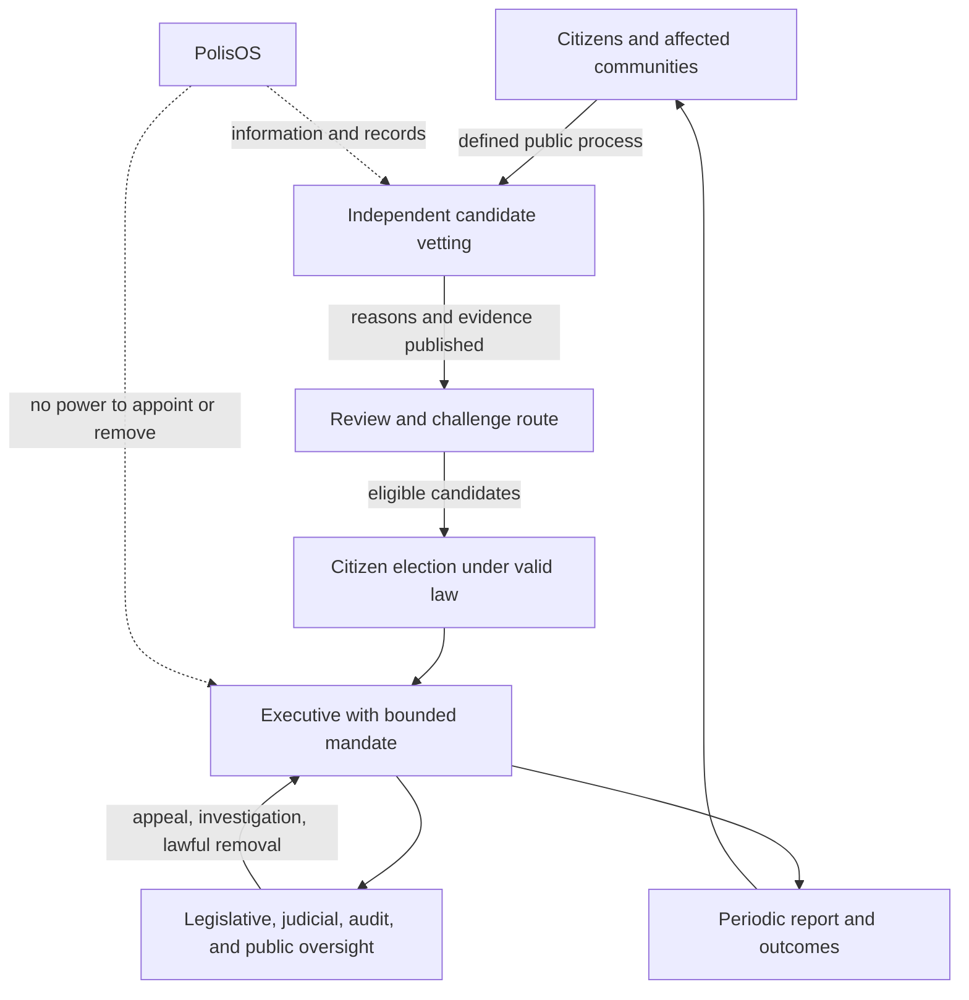

# Governance Authority and Project Roles

## Purpose and outcomes

This chapter distinguishes civic participation, project coordination, and state authority. The initial workflow lets citizens identify problems, compare options, and organize scoped projects. A project role system can help a team coordinate work; it must never silently become a hierarchy over the population.

## Governance model now

The platform is an information, coordination, simulation, transparency, and accountability system that operates alongside existing institutions. Public powers remain with bodies established by law. A platform record of a vote, proposal, or project status is not itself a legal decision unless a competent body has explicitly given it that effect under a valid legal process.

## Company-inspired organization

Companies can offer useful operating practices: clear objectives, named owners, role clarity, budgets, decision logs, milestones, and feedback. Their internal hierarchy is not a source of democratic legitimacy and profit maximization is not an adequate national objective. PolisOS may borrow project execution practices while keeping public authority accountable, contestable, rights-bound, and separated.

### Scoped project roles

| Role | Typical responsibility | Authority limit |
|---|---|---|
| Contributor | Completes a volunteered task and records work | No authority over team members |
| Specialist | Provides documented domain advice or review | Advice is not approval |
| Workstream lead | Coordinates an agreed workstream | Can decide only within the charter and budget |
| Project lead | Integrates delivery, risks, and milestones | Cannot expand legal authority, scope, or budget unilaterally |
| Sponsor / accountable owner | Secures mandate, resources, and decision route | Must be an identified lawful institution or consenting sponsor |
| Independent reviewer | Reviews evidence, safety, conflicts, and outcomes | Must disclose conflicts and can recommend stop or correction |

Roles are named per project, selected against published criteria, time-bounded, reviewable, and removable through a defined process. No citizen has a permanent “employee-to-CEO” rank across society. Work is voluntary unless separately governed by a lawful employment or public-service relationship.

## Future national governance proposal

The long-term preference is a company-inspired national executive structure with citizens choosing among independently vetted candidates. This is a proposal for analysis, not an adopted constitutional model. It must be tested against Romania’s current constitutional order, fundamental rights, representative institutions, separation of powers, elections, referendums, courts, and local autonomy. The Constitution describes Romania as a democratic republic and states that sovereignty belongs to the people and is exercised through representative bodies and referendums ([official text](https://legislatie.just.ro/Public/DetaliiDocumentAfis/1413)). No software design can override that legal framework.

A future proposal must answer: who vets candidates and by what non-discriminatory criteria; how citizens challenge the vetting body; how executive and legislative authority remain separate; how courts remain independent; how elections, terms, recall, succession, emergency powers, and peaceful transition work; what local and minority protections apply; how conflicts of interest and capture are prevented; and what constitutional amendments or legislation would be required. Independent constitutional counsel and public deliberation are prerequisites.

## Decision and authorization record

Every public-impacting project or policy option should record the question and legal/institutional owner; authority and scope of the decision-maker; affected groups and participation method; evidence, provenance, uncertainty, and alternatives; value trade-offs and distributional effects; decision, reasons, dissent, budget, and implementer; and review date, measures, appeals, and stop conditions.

Distinguish binding decisions from consultations, polls, project votes, and advisory rankings.

## Failure modes and appeals

Safeguards include public role criteria, conflict disclosures, term limits for project roles, independent review, accessible appeal, anti-retaliation controls, audited moderation, and conflict-of-interest checks. Do not use a single reputation score to allocate work or infer leadership ability. Do not let the project owner be the sole reviewer of their own work.

## Stack and delivery

Governance records use shared identity, event, audit, and interface services. Voting is not in the initial workflow. Any legally consequential electronic voting needs a separate threat model, independent verification, accessibility plan, legal analysis, and security evaluation; a normal web poll is not a secure election system.

Open items: constitutional compatibility, candidate vetting authority, election and succession models, institutional appeal path, and legal basis for each decision type.

