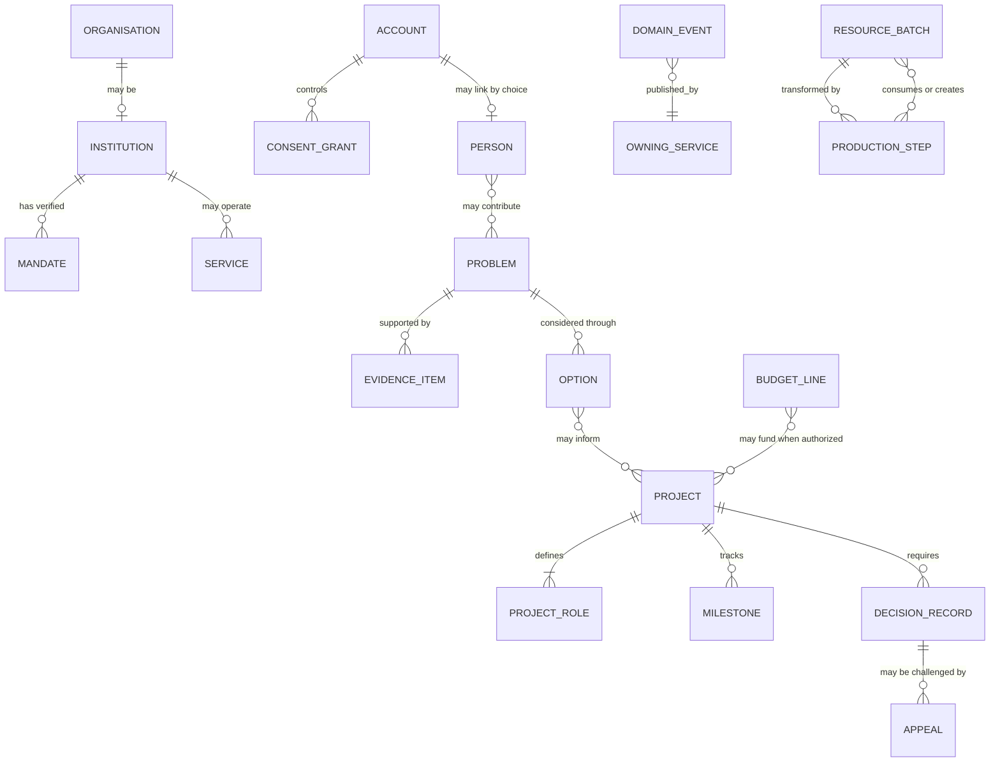
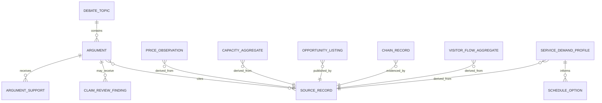

# Core Ontology and Entity Boundaries

## Purpose

This README defines the vocabulary shared by domain services. It is a coordination model, not a requirement to collect every field or create a central person database. Each domain owns its records; cross-domain relationships use explicit contracts and permissions.

## Core entities

| Entity | Owner | Required meaning | Privacy and authority invariant |
|---|---|---|---|
| Account | D01 | Authentication, recovery, security status | Not equivalent to legal identity or eligibility |
| Person | D01 / citizen | Optional minimal participant profile | No compulsory life dossier, biometrics, global rank, or inferred traits |
| ConsentGrant | D01 / data steward | Purpose, scope, version, time, withdrawal | Separate from service terms; never bundled across purposes |
| Organisation | D02 | Legal or self-described group identity | Does not imply public authority |
| Institution | D02 | Organisation plus verified mandate and accountable owner | Platform cannot create its mandate |
| Mandate | D03 / competent authority | Legal source, scope, validity, responsible body | Must cite an authoritative source and effective dates |
| Service | D05 / service owner | Public or civic offering, eligibility/info, access path | Directory entry is not a service entitlement decision |
| Problem | D16 / workflow owner | Scoped adverse condition, location/time, affected scope | Focus on condition and evidence, not blame or person score |
| EvidenceItem | Domain owner | Source, author/attribution, method, timestamp, license, uncertainty | Claims remain contestable and correctable |
| Option | Project workflow | Proposed response, assumptions, costs, effects, risks | Not an authorized decision |
| DecisionRecord | D03 / competent owner | Decision-maker, authority, reasons, evidence, date, review | Platform cannot create authority through a record |
| Project | Project service | Time-bounded objective, charter, owner, funding, milestones | No permanent citizen rank or assignment |
| ProjectRole | Project service | Scoped responsibility, permissions, term, selection basis | Authority only within project charter and time window |
| Milestone | Project service | Deliverable, owner, due date, evidence, status | A self-report is labeled as such until verified |
| Observation | Domain owner | Measurement/contribution with source and collection purpose | Personal observation requires explicit opt-in |
| Indicator | D12 | Definition, scope, cadence, uncertainty, permitted interpretation | Cannot become an automated individual sanction |
| Appeal | D03/D14 | Contested action or data, reviewer, decision, reason, status | Reviewer independent from original decision where possible |
| DomainEvent | Owning service | Versioned fact, producer, timestamp, classification, correlation | Minimal payload; no hidden command or sensitive narrative |
| ResourceBatch | D07 | Material/resource identity, quantity, origin, custody | Public exposure depends on safety and commercial confidentiality |
| ProductionStep | D07 / producer | Inputs, transformation, output, facility scope, time, uncertainty | Supports traceability without exposing worker personal data |
| BudgetLine | D17 | Authorized allocation, period, program, execution state | No redirection of funds by dashboard or platform vote |
| Policy | D03 | Proposal, legal owner, status, impact, review | Proposed policy remains distinct from binding law |

## Relationships

The relationship diagram is conceptual. Do not build a globally queryable personal relationship graph. A join is a separate data-use decision, not an automatic consequence of shared IDs.

## Invariants

1. Account, person, legal identity, and service case are distinct concepts.
2. No universal citizen record or default cross-domain government-record join.
3. A project role is project-scoped, expires, and does not change a person’s public status.
4. Evidence records source, method, uncertainty, license/permission, and correction history.
5. An option or simulation does not imply authorization.
6. A decision record names a competent decision-maker and authority source.
7. An indicator has documented limits and cannot autonomously decide a person’s eligibility.
8. Personal contribution is opt-in, purpose-specific, and separately revocable where possible.
9. Domain events are facts and carry the minimum necessary data.
10. Resource and production tracing may expose economic steps but must protect workers, security-sensitive sites, and legitimate commercial information.

## Schema evolution

Each domain owns its schema and migration history. Shared identifiers are stable, non-semantic, and non-sensitive. Breaking changes require a compatibility plan and consumer inventory. Event schemas are versioned independently from storage schemas. Corrections create an auditable revision rather than silently rewriting history.

## Open decisions

Canonical geography, organization identifiers, legal references, project and event IDs, cross-domain provenance format, and retention rules remain to be agreed.

## Additional operating-picture entities

The following entities are proposed for the national operating picture. They extend the core vocabulary without creating a central citizen profile. The owning service decides whether a proposed entity is needed and defines its schema before production use.

| Entity | Owner | Minimum purpose-bound fields | Privacy/authority invariant |
|---|---|---|---|
| DebateTopic | D03 | Question, scope, domain, moderator, opened/closed dates, status, decision owner | Topic popularity does not create authority |
| Argument | D03 | Topic, pro/con position, claim text, reasoning, source references, correction history | Do not use author identity, support count or stance as a citizen rank |
| ArgumentSupport | D03 | Argument, non-public participant reference where required for abuse prevention, created/retracted times | Public total is an aggregate participation count, not a truth score |
| ClaimReviewFinding | D11 | Text span, dimension, finding, source reference, uncertainty, model/version, challenge status | Advisory only; never silently changes a legal or policy state |
| SourceRecord | D10 | Controller/steward, URI/identifier, license/authority, method, coverage, update, quality and correction path | A source reference does not grant access or unrestricted reuse |
| PriceObservation | D04 | Item/service spec, quality, unit, price, region, channel, date, source, method and revision | No receipt/account identifier in public series; opt-in inputs stay purpose-limited |
| CapacityAggregate | D09 | Specialty/occupation taxonomy, geography, period, metric meaning, value, coverage and suppression state | Aggregate data; not a roster of workers or shift availability |
| OpportunityListing | D04 | Publisher, role/opportunity, skill taxonomy, region, type, active dates, source and correction | Not an employment decision or guaranteed offer |
| ChainRecord | D07 | Product/batch, input/output links, quantity/unit, origin, transformation, custody, evidence and confidence | Protect worker identities, trade secrets, and sensitive sites |
| VisitorFlowAggregate | D04 | Attraction/area, time range, aggregation method, count band, coverage and resident-impact context | No device-level tracking or individual movement history |
| ServiceDemandProfile | D05 | Service, region, time bucket, demand/capacity measure, source, threshold and uncertainty | Individual activity and schedules are excluded |
| ScheduleOption | D05 | Current/proposed hours, expected effects, costs, worker impacts, authority and review date | Option is advisory until approved by the lawful service owner |

These contracts and their data-specific rules are expanded in the [national operating picture](../system/operating-picture/README.md).

