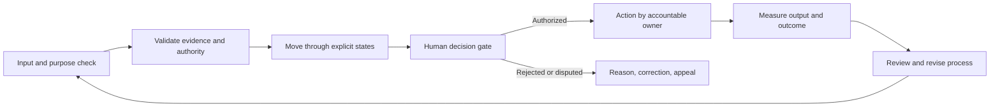

# Process Catalog and Workflow States

## Purpose

The process catalog decomposes work into states, actors, inputs, outputs, failure handling, measures, and appeal paths. A workflow engine may route tasks and show status, but only an authorized human or institution can make a decision that requires public or legal authority.

## A Citizen Problem to Project

See the full first-release chapter at [problem-to-project workflow](../first-workflow/README.md). The key states are:

| State | Entry condition | Responsible actor | Exit evidence |
|---|---|---|---|
| Draft | Contributor starts an optional report | Contributor | Explicit submit action and visibility choice |
| Submitted | Required minimum fields provided | Workflow service | Receipt, purpose, attribution, time |
| Triage | Report accepted into review queue | Triage reviewer | Scope, safety and duplicate check |
| Needs evidence | Missing or unclear item blocks review | Contributor | Specific request and correction |
| Under review | Routed to domain steward | Domain reviewer | Provenance-based review and reason |
| Discussion | Safe summary is available | Facilitator | Accessible views, disagreement and evidence summary |
| Options | Feasible responses are recorded | Proposer and reviewers | Alternatives, costs, risks, affected people |
| Decision pending | Project charter is complete | Competent owner | Authority, funding, owner, measures, stop criteria |
| Authorized / declined | Responsible owner decides | Authorized owner | Reasoned record and appeal route |
| Active | Scope and resourcing accepted | Project team | Milestones and progress evidence |
| Evaluating | Delivery milestone or closure reached | Independent reviewer | Outcome, effects, uncertainty, lessons |
| Closed | Review complete or work stopped | Accountable owner | Final status, records, retention and next steps |

Failures: invalid authorization, privacy exposure, missing funding, unsafe work, evidence dispute, or an appeal that changes the plan. Use idempotent events, compensating actions, visible status, and a human fallback.

## Future permit and administrative workflows

A permit or license process must be mapped to the actual statute, official owner, required evidence, deadlines, fees, notice, appeal, and records-retention rules before software is designed. An example state model is:

```Draft → Submitted → CompletenessReview → TechnicalReview → DecisionPending → Approved / Refused → Appeal / Closed```

The platform may provide guidance, a checklist, status visibility, and a route to the official service. It must not issue the permit unless the lawful authority explicitly delegates that function and meets required procedure.

## Future organisation registration

Company or cooperative registration may be documented as an official-service navigation flow, with links to official registry, status and requirements. PolisOS does not duplicate official legal registration or invent organization identifiers. A future integration needs a legal basis, service owner, correction route and safe data exchange contract.

## Workforce enrollment and project participation

Workforce enrollment is split by purpose:
- Voluntary project participation records project-specific role, skills evidence relevant to the role, expected workload, term, and exit.
- Employment contracts, payroll, taxes, pensions, benefits, and statutory worker enrollment remain in the responsible employer and government systems.
- A platform CV or skill portfolio is optional and is never automatically sent to an employer or used for public service eligibility.
- No continuous attendance, location, productivity, or behavior surveillance is part of the civic workflow.

## Common process contract

For every workflow document: purpose; legal/organizational owner; participant roles; inputs and source; preconditions; state transitions; decision authority; outputs and events; expected latency; failure modes; compensation or rollback; metrics and uncertainty; privacy and retention; notices; appeals; accessibility; and operating/support owner.



## Events and failure handling

Events describe facts such as ReportSubmitted, ReviewRecorded, ProjectAuthorized, MilestoneReported, AppealFiled, and OutcomeEvaluated. Consumers are idempotent. Events have a schema version, source, event time, trace ID, purpose and classification. For multi-domain workflows, define a saga owner, timeout, retry policy, compensating event, dead-letter review, and user-visible status. Exactly-once delivery is not assumed for business outcomes.

## National operating-picture processes

The [operating picture chapter](../system/operating-picture/README.md) adds these service workflows. They are blueprint scope; the current control-room UI uses synthetic demo data.

| Process | Main states | Required review or stop condition |
|---|---|---|
| Debate and claim review | Topic draft → scoped/open → argument and source submission → optional AI review → human correction/rebuttal → options brief → authorized decision or deferred → evaluation | Missing scope/source, unsafe personal content, unsupported AI finding, disputed moderation, or no competent decision owner |
| Source and indicator publication | Source proposed → permission/license check → schema/method review → published → refreshed/revised → correction/dispute → retired | Unclear source rights, broken lineage, unreported revision, privacy/small-cell risk, or inadequate quality |
| Price observation | Source event or opt-in sample → item/unit/quality validation → outlier/sampling review → regional time-series publish → revised/corrected | Promotions or package mismatch; no source/date; biased coverage; attempted household identification |
| Specialist capacity aggregate | Registry/organization count → taxonomy and definition validation → suppression threshold → aggregate release → refresh/revision | Count meaning is ambiguous, small group is re-identifiable, or a dashboard is mistaken for named availability |
| Job/opportunity listing | Publisher verification → active listing → expiry/reconfirmation → correction/dispute → removal | Misleading employer, expired vacancy, unlawful use of applicant data, or personal profiles repurposed for matching |
| Supply-chain trace | Chain/batch registration → transformation/custody events → quantity reconciliation → safe disclosure review → correction/attestation → end-of-life | Confidential or security-sensitive field, false provenance, mass-balance gap, or unverified link shown as fact |
| Service schedule analysis | Aggregate demand intake → threshold and coverage check → alternatives/cost/worker-impact assessment → human service-owner decision → pilot → evaluation/revert | Individual schedules exposed, unsafe aggregation, staff impact omitted, or service authority not identified |

Representative facts may include `DebateOpened.v1`, `ArgumentSubmitted.v1`, `ClaimReviewCompleted.v1`, `PriceObservationPublished.v1`, `CapacityAggregatePublished.v1`, `VacancyPublished.v1`, `ProductionStepAttested.v1`, `DemandProfilePublished.v1`, and `ScheduleOptionCompared.v1`. These names remain proposals until service owners approve version, purpose, classification, retention, and compatibility rules.

## Measures and appeals

Measure completion time, time in each state, correction rates, appeal outcomes, accessibility failures, data quality, and outcome measures. Publish distributions and uncertainty instead of only averages. Do not optimize throughput by weakening due process or hiding unresolved cases.

