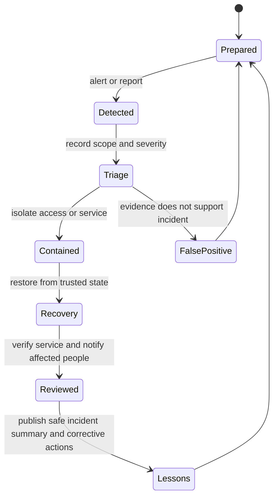

# Security Privacy and Resilience

## Purpose and outcomes

Security protects people, services, evidence integrity, and the legitimacy of decisions. The platform should assume compromised accounts, malicious submissions, insider misuse, service outages, manipulated data, and hostile external traffic. A country-scale platform is a high-value target and should not launch sensitive integrations before independent security review.

## Security principles

- Threat model each service and workflow before collecting sensitive data.
- Minimize information stored and the duration it is retained.
- Enforce least privilege, separation of duties, strong account recovery, and multi-factor authentication for privileged users.
- Encrypt in transit and at rest; manage keys separately from application data.
- Use short-lived scoped credentials and auditable operator access.
- Separate security incidents from civic content and project decisions.
- Protect integrity and provenance; tamper-evident logs do not prove an input was true.
- Use privacy-safe telemetry with redaction, access controls, and retention limits.
- Publish vulnerability reporting, response ownership, and security advisories.
- Maintain encrypted backups, recovery exercises, and offline continuity plans.
- Use independent penetration tests, accessibility reviews, data-protection review, and adversarial exercises before high-impact launch.

## Trust boundaries

- Browser/device to public edge.
- Public edge to identity provider and application API.
- Service-to-service traffic over authenticated APIs and Kafka ACLs.
- Each domain service to its privately owned data.
- Production to analytics and public aggregate publication.
- Operator workstations to production administration.
- Build pipeline and software dependencies to signed releases.
- Backups and disaster recovery environment to production.

## Identity and authorization

A login is not proof of citizenship, legal identity, or eligibility. Use stronger proof only for a feature with a documented legal purpose. Do not collect biometrics for generic authentication or attach a biometric commitment to a universal citizen profile. The earlier ontology's biometric commitment field conflicts with the current minimisation and opt-in direction and is not adopted, pending a narrowly justified, independently reviewed use case.

Authorization is checked server-side for every action. Project roles carry explicit project ID, scope, expiry, and permitted actions. Staff and reviewers use stronger authentication; privileged access is just-in-time and reviewed. Avoid global administrator accounts and unlogged break-glass paths.

## Abuse and manipulation controls

Threats include bots, Sybil attacks, harassment, coordinated brigading, false evidence, impersonation, forged provenance, doxxing, coercion, retaliation, malicious project capture, and account takeover. Countermeasures must be proportionate and appealable. Identity checks can exclude lawful participants and create privacy risks; use tiered trust and independent review rather than requiring real-name publication.

No universal social score, behavioral risk score, opaque citizen ranking, or covert political persuasion. Recommendation and moderation systems show rules, disclose automation, provide appeal, and avoid sensitive-trait inference.

## Defense and sensitive information

The civic platform is not a military command system. Do not store operational targeting, readiness vulnerabilities, sensitive facility layouts, intelligence sources, or classified plans in public workflows. Defense-related public reporting uses an authorized release process and safe aggregation. Emergency information must be authenticated, time-bound, corrected quickly, and distinguished from official legal orders.

## Incident and recovery loop

A security response may restrict access temporarily to contain harm, but must preserve a review trail and restore lawful access promptly. Affected people need clear notice where appropriate, a correction path, and support against retaliation.

## Stack record and operations

Use FOSS components where practical, but count skilled operators, managed hosting if chosen, backups, egress, support, monitoring, audits, incident response, and upgrades. Cross-cutting security services have not been selected. Required evaluation fields are license, maintenance health, security advisories, data location, key control, interoperability, export, recovery, and replacement cost.

## Open questions

Data protection officer and independent security roles; hosting threat model; identity proofing scope; threat reporting channel; incident notification process; security classification policy; recovery time and recovery point objectives.

