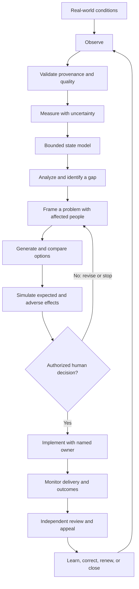

# System Blueprint and Boundaries

## Purpose and outcomes

PolisOS is a proposed civic information and coordination platform for Romania. Its first capability helps people turn a problem into evidence, options, a scoped project proposal, and visible progress. Over time, separate domain services may support public-service improvement, infrastructure coordination, economic and environmental analysis, and transparent institutional delivery.

The platform starts alongside existing institutions. It supports people who choose to participate and institutions that voluntarily use it under a defined legal basis. It does not replace the Romanian state, constitutional bodies, courts, elections, or public administration.

## System boundary

| In scope for the platform | Outside the platform’s inherent authority |
|---|---|
| Publish sourced information and its uncertainty | Make laws or exercise public power by software |
| Collect voluntary proposals, evidence, discussion, and review | Compel a citizen to create an account or contribute data |
| Compare options and show assumptions | Treat a model score as legal proof or human worth |
| Coordinate opt-in project teams and milestones | Assign work or a permanent social rank to a person |
| Record decisions made by authorized humans or institutions | Decide eligibility for benefits, employment, healthcare, policing, or justice |
| Measure aggregate service and project outcomes | Link government person-records by default |
| Provide an audit trail and routes to correction | Expose sensitive defense, health, child, or security information |

Earlier drafts contain more expansive concepts, including personal health tracking, dating, social graphs, public profile rankings, skill scores, biometric commitments, automated analysis, and broad national dashboards. These are not adopted defaults. They require separate necessity, legal-basis, threat, child-safety, and consent reviews. Several should remain outside the platform.

## System principles

- Judge proposals against declared outcomes and evidence, not a presumed economic ideology.
- Keep constitutional legitimacy, rights, due process, separation of powers, and human appeal as system constraints.
- Model uncertainty, provenance, adverse effects, and distributional impacts.
- Make actions reversible where practical; define a stop path where they are not.
- Separate platform capability from public authority.
- Do not give AI sovereignty, hidden political authority, or unreviewable control over people.
- Support offline and degraded operation for critical service continuity.
- Treat transparency as purpose-bound; publication is not a reason to disclose private or security-sensitive data.

## System control loop

The loop is not automatic. Each transition needs an accountable actor, evidence, a time bound, and a route to challenge errors. A control-system analogy can improve feedback and stability, but society is not a machine: citizens have rights, values conflict, measurements are incomplete, and affected people need meaningful voice.

## National reach and rollout

The chosen audience is national from day one: the first voluntary workflow should be accessible to people across Romania, with multilingual and accessible design. National availability does not mean nationwide data integration, compulsory enrollment, or immediate execution of public projects. Early projects need named local or institutional owners, explicit authority, funding, and an evaluation plan.

This resolves older planning material that proposed a single pilot jurisdiction. A small number of bounded, voluntary projects may be piloted within a nationally available platform; that is a delivery strategy, not a restriction of the intended audience.

## Model concepts

See [core ontology](../ontology/README.md) for entity boundaries and invariants, and [process catalog](../process-catalog/README.md) for workflow state conventions.

| Concept | Meaning | Must not be confused with |
|---|---|---|
| Account | Authentication and recovery handle | Legal identity or complete citizen record |
| Person | Optional, minimal profile subject | Account credential |
| Organisation | Public, private, cooperative, civic, or academic entity | A service owner by default |
| Institution | Organisation with a defined public or delegated responsibility | Platform itself |
| Problem | A scoped, sourced statement of an adverse condition | A person to blame |
| Evidence | A claim-supporting source with provenance and uncertainty | An unquestionable fact |
| Option | A possible intervention and its assumptions | An authorized decision |
| Project | Time-bounded coordinated activity with owner, scope, budget, milestones | Permanent employment or citizen rank |
| Role | Limited authority within one project or lawful institution | A national social level |
| Observation | Recorded measurement or contribution for an explicit purpose | Permission to monitor an individual |
| Indicator | A defined measure, including denominator, scope, cadence, uncertainty | A value judgment |

## Decisions and unresolved questions

The [reconciliation record](../source-reconciliation/README.md) details source conflicts. Open items include legal review of future governance arrangements, appropriate legal basis for public-sector integrations, long-term funding, independent audits, and which institutions may authorize each class of project.

## National operating picture

The [operating picture and system services](operating-picture/README.md) expands the initial problem-to-project slice into a system-of-systems blueprint. It defines separate services for debate and evidence, specialist capacity, prices and affordability, jobs and training, production and trade, tourism, and public-service scheduling, alongside the shared observation contract and control loop.

The main web screen is now an illustrative local control-room prototype for those modules. Its sample values and AI-review text are demonstrative only. No national data feeds or AI model are connected. National availability of the interface does not imply that operational sources are live from day one.

