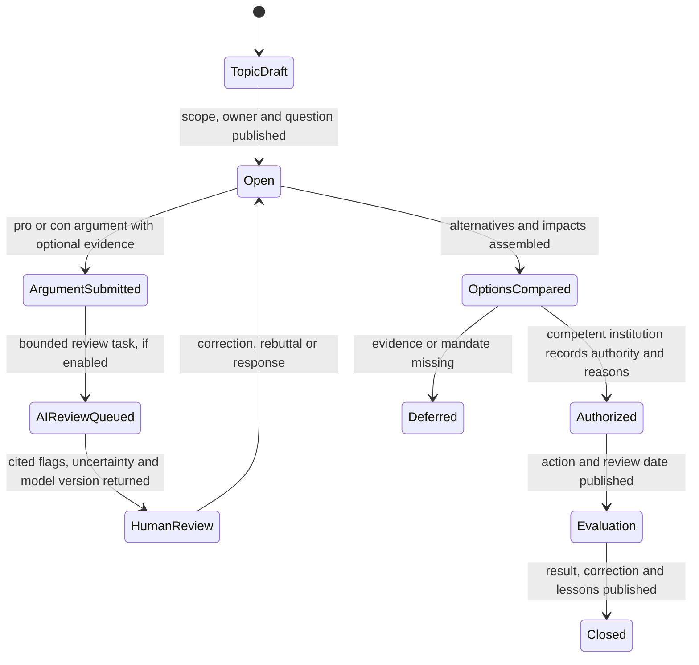

# National Operating Picture and System Services

## Purpose

This chapter turns the PolisOS ambition into a system-of-systems blueprint. The platform should help people and accountable institutions observe how services and economic systems are working, understand evidence and trade-offs, coordinate a response, and learn from the result. “Operating system” describes the shared coordination and feedback layer. It does not make software the sovereign authority over the country or its citizens.

The public interface can be available nationally from the beginning. Real integrations, operational decisions, and service changes must be introduced in bounded stages with the responsible institutions and communities.

## Product boundary

PolisOS can join signals that have an explicit owner, purpose, source, method, time window, geographic scope, uncertainty, and correction path. It can reveal a gap, bring people together, compare options, model scenarios, and track an authorized action. It cannot turn a metric, model, majority, or project role into legal authority by itself.

The core operational cycle is:

```mermaid
flowchart LR
  O[Observe a domain] --> P[Provenance and permission]
  P --> M[Measure with scope and uncertainty]
  M --> D[Diagnose a service gap or opportunity]
  D --> B[Debate evidence and alternatives]
  B --> S[Simulate cost, benefit, risk and distribution]
  S --> A[Authorize through a competent human institution]
  A --> W[Deliver with owner, budget and milestones]
  W --> E[Evaluate real outcomes and unintended effects]
  E --> L[Correct, scale, pause or stop]
  L --> O
  B -. AI support only .-> H[Human review and correction]
  H --> S
```

## System modules

| Module | Domain owners | What the service observes | Main records and outputs | Hard boundary |
|---|---|---|---|---|
| National control room | D10, D12, D13, D16 | Published indicators, source freshness, service status, open decisions and delivery milestones | Domain status, provenance coverage, exceptions, decision and project links | A dashboard is a read model; it cannot dispatch public authority or hide uncertainty |
| Public deliberation and evidence | D03, D10, D11, D16 | Questions, arguments, citations, counterarguments, corrections and review history | Topic, claim, argument, source, support, review note, resolution | Support counts show participation, not truth or citizen merit; AI output is advisory and contestable |
| Workforce and specialist capacity | D04, D09, D10, D12 | Aggregated qualifications, staffing, vacancies, training flow, location and time-limited availability | Capacity aggregate by taxonomy/region/period; skills pathway; gap report | No universal worker roster, named shift tracking, employment score or automatic deployment |
| Prices and affordability | D04, D05, D12, D16 | Official tariffs, licensed market series, representative surveys and voluntary price observations | Comparable price observation, basket series, affordability context, source coverage | Price signals request review; they do not set or enforce prices |
| Jobs, employers and opportunities | D04, D09, D10, D16 | Verified public vacancies, employer and training listings, occupation demand and expiry | Job opening, skills, region, training pathway, business opportunity | A listing is not a guarantee and civic activity/profile data are not hiring inputs |
| Production, imports, exports and supply chains | D04, D07, D08, D13, D17, D20 | Resource origin, batch, transformation, logistics, inventory dependencies, import/export and end-of-life | Resource batch, production step, custody link, aggregated trade flow, risk note | Commercial, worker and security-sensitive information is access-controlled or aggregated |
| Tourism and visitor economy | D04, D05, D06, D08, D16 | Attraction metadata, access, transport, seasonal demand, local services and community effects | Attraction, access condition, visitor-flow aggregate, seasonality and impact indicators | Crowd/load indicators do not automatically restrict movement or access |
| Public-service time planning | D05, D06, D09, D12 | Aggregate demand by hour/day/season, service hours, wait times and published schedules | Demand profile, proposed service window, cost/worker-impact assessment | No routine collection of named citizens’ or workers’ schedules; only safe aggregates |
| Delivery and public finance | D02, D03, D13, D14, D17 | Mandate, budget authority, procurement, contracts, project milestones, service output and evaluation | Decision record, authorized budget line, milestone, public outcome report | A platform vote or simulation cannot release or redirect funds |
| Resilience, environment and essential infrastructure | D05, D06, D08, D15, D19 | Safe, aggregated supply, asset condition, outage, emissions, resource and continuity measures | Risk register, maintenance priority, scenario and recovery indicator | Defense, critical infrastructure and personal location detail are not shown in public views |

### Debate to decision

Arguments should be structured around one main claim, reasoning, scope, and evidence. A participant can add a new pro/con argument, support an existing one, offer a rebuttal, or flag a source or review. Support totals are locally meaningful participation signals only; they do not rank participants, establish truth, or select a policy.

### AI argument review contract

The proposed D11 service reviews individual claims and reasoning, not whether a person is good or whether a policy should win. It should return:

| Review dimension | Expected output |
|---|---|
| Factual claims | Claim spans, checkable status, candidate sources, source date and disagreement |
| Assumptions | Necessary but unstated premises, labeled as interpretation rather than fact |
| Reasoning | Possible causal leap, invalid inference, missing comparison, or valid limitation with cited span |
| Personal attacks | Specific text span and rule category; no inference about intent or character |
| Evidence quality | Citation relevance, primary/secondary status, date, methodology and missing context |
| Confidence and coverage | Per-finding uncertainty, languages/topics not covered, and reasons to abstain |
| Human correction | Challenge, edit, appeal, reviewer, model/version, and visible decision history |

The model must quote or link the part of the argument it is discussing and distinguish “not verified” from “false.” It must be evaluated on Romanian language and relevant dialects, political viewpoint balance, minority topics, source accessibility, adversarial prompts, and false accusations. The interface must not display an AI finding as a binding verdict. No current AI model is connected in the web prototype.

## Observation and data contracts

Each domain observation uses a shared envelope with: `observation_id`, `domain`, `metric_or_claim`, `value`, `unit`, `geography`, `time_window`, `observed_at`, `source_id`, `method`, `coverage`, `uncertainty`, `classification`, `purpose`, `steward`, `license_or_authority`, `retention`, `revision`, and `correction_route`.

The domain owner stores detailed source data. D12 owns shared indicator definitions and measurement quality; D10 owns the catalog and provenance reference; D13 records material changes and authorizations; D16 renders safe approved aggregates. Cross-domain dashboards consume published read models, never perform unbounded joins over personal records.

### Data-specific rules

- **Specialists:** define whether a count means licensed persons, active practitioners, posts, full-time equivalents, or available hours. Prefer official registers and institution-level aggregates; report coverage and update date. Small regional cells are suppressed or widened.
- **Prices:** store item/service specification, grade/quality, package/unit, taxes, promotion status, region, channel, observed date, source, method and revision. Do not blend like-named but non-comparable items. Keep a basket of fuel, electricity, water, bread, pork, beef, tomatoes, potatoes, cabbage, carrots, waste collection, public transport, rent, and ride-sharing, then allow regional extensions.
- **Jobs and businesses:** record who published the listing, valid-from/to, occupation/skill taxonomy, region, work pattern if explicitly published, training route, compensation range when lawfully available, accessibility information, and removal/correction link. Do not infer a citizen’s employability from their civic activity.
- **Trade and chains:** connect batches to inputs, transformation quantities, facilities at an appropriate public granularity, custody, outputs, losses, reuse, export and end-of-life. Mark self-reported, audited, estimated and unknown links distinctly.
- **Tourism:** describe attractions, opening/access conditions, transport, seasonal capacity and aggregate visitation where a lawful source exists. Include residents’ costs, environmental pressure and local jobs rather than maximizing visitor counts alone.
- **Time use:** prefer service transactions and capacity statistics aggregated by hour/day. Optional research participation must be separate, revocable, and thresholded; do not request employer rosters or named shift histories for national planning.

## Proposed service boundaries and events

Every domain is independently deployable and owns its store. Initial API/event names are proposals and must receive an owner, schema version, purpose, retention and access classification before production:

| Producer | Example fact event | Consumer/read model |
|---|---|---|
| Deliberation service | `DebateOpened.v1`, `ArgumentSubmitted.v1`, `ArgumentSupported.v1`, `ClaimReviewCompleted.v1`, `ArgumentCorrected.v1` | Debate page, D11 evaluation, public decision brief |
| Capacity registry | `CapacityAggregatePublished.v1`, `VacancyPublished.v1`, `TrainingPathwayChanged.v1` | Workforce dashboard, education planning, opportunity search |
| Price observatory | `PriceObservationPublished.v1`, `BasketSeriesRevised.v1`, `TariffChanged.v1` | Affordability dashboard, policy analysis, alert triage |
| Chain registry | `ProductionStepAttested.v1`, `ChainLinkCorrected.v1`, `TradeAggregatePublished.v1` | Product trace, import concentration view, environmental analysis |
| Visitor and access service | `AttractionAccessUpdated.v1`, `VisitorAggregatePublished.v1` | Tourism planning, transport and environmental dashboards |
| Service schedule | `DemandProfilePublished.v1`, `ScheduleOptionCompared.v1` | Service owner and public-service dashboard |
| Decision and project service | `DecisionAuthorized.v1`, `MilestoneReported.v1`, `OutcomeEvaluated.v1` | Project workspace, public finance and audit views |

Events carry a reference to protected evidence rather than a copy of its full content. Event payloads do not include account email, government record identifiers, raw receipts, individual shift history, or unredacted health data.

## System monitoring and exceptions

The control room distinguishes three kinds of status:

1. **Service telemetry:** availability, latency, queue depth, failure and security signals for PolisOS software. This is not a measure of citizens or national quality of life.
2. **National outcomes:** published domain indicators with methods, source, population, geography, revision history and uncertainty. An indicator can prompt review, not impose a penalty.
3. **Personal contributions:** optional reports, debates, skills or surveys with separate purpose, visibility and withdrawal/correction controls.

An alert is triaged through: verify freshness and data quality → reproduce against the source → assess people and service impacts → assign a human owner → publish or restrict the incident record → authorize response through the existing institution → track resolution and review. Thresholds, budgets and emergency authority belong to named, lawful owners; software rules can route a notification, never silently execute a coercive action.

## Citizen experience and roles

Citizens can read public data without an account where safe, inspect sources and definitions, discuss a topic, contribute evidence, correct an error, and follow a project. Signing in enables voluntary contributions and private preferences. A person is not required to create a complete life profile to use a public dashboard. Professional qualifications remain verified by the relevant issuer; project responsibilities expire with their charter. There is no universal citizen rank.

## Delivery stages

| Stage | Deliverable | Exit evidence |
|---|---|---|
| 0 · Product model | Service map, entity model, rights, source and authority contract | Domain owners, affected users and security/privacy reviewers agree on boundaries |
| 1 · Local control-room prototype | Navigation and illustrative interfaces for all modules; local debate interaction | Every sample marked as fictional; no claim of live national monitoring; accessibility review |
| 2 · Evidence and deliberation service | Topic/argument/source lifecycle, support, moderation, corrections and audit | Abuse model, content rules, API/event contract, verified test corpus and human appeal |
| 3 · Source registry and indicators | Price, capacity, jobs, trade, tourism and service schedule definitions plus one approved aggregate source per pilot | Rights to reuse, lineage, quality checks, steward, update cadence and correction path |
| 4 · Bounded regional integrations | Federated data exchange and service-owner workspaces for selected domains | Legal/security review, service agreement, published data gaps and independent evaluation |
| 5 · Scenario and improvement loops | Compare scheduling, workforce, affordability and supply resilience options | Human authorization, transparent assumptions, affected-group review, evaluation and stop rules |

National access is compatible with staged integration: users can discover the platform nationally while each data source and operational service is added only when its owner is ready and accountable.

## Suggested additional systems

The D01–D20 map already includes health, education, transport, infrastructure, environment, public finance, law, administration, defense and diplomacy. To make the operating picture useful, add domain views for primary-care and hospital access; school places and learning pathways; transit punctuality and road/rail maintenance; electricity, water and waste capacity; housing and homelessness services; agriculture yield/storage/inputs; procurement-to-delivery; environmental pressures; and civil preparedness. Each should start with service outcomes and safe aggregate data, not a central personal dossier.

## Open decisions

National taxonomy for occupations and product units; trustworthy source inventory and licensing; privacy thresholds for regional aggregates; debate moderation and independent AI evaluation; service-level ownership and funding; economic data confidentiality; consent and compensation for any participatory time-use research; and the legal/operational boundary between a public dashboard and institutional command software.
